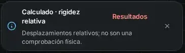

# FStructure · resultados sin desvíos a Model Doctor

26 de octubre de 2026 · base `55e1d0a0a44075be04473264bdc139786d8d4877`

## Causa reproducida

El aviso de análisis con rigidez relativa enlazaba a Model Doctor aunque la solución numérica fuera fiable. Cuando aparecía también `small-displacement-assumption`, se convertía en una advertencia genérica permanente que ocupaba gran parte del canvas. Los diagnósticos originales de una corrida resuelta no estaban disponibles junto a todos sus diagramas en Resultados.

Se reconstruyó un caso compatible con la captura: viga de 7 m, rodillo vertical izquierdo, guía derecha que restringe X y giro pero permite Y, carga puntual de 10 kN a 2.891 m. Sin cambiar el solver se obtienen Ry izquierda = 10 kN y momento de reacción derecho = 28.91 kN·m. Con EI de referencia aparecen `relative-stiffness` y `small-displacement-assumption`, con calidad numérica fiable. Esta reconstrucción no es el archivo original del usuario ni una validación de una estructura física.

## Cambios

- Todos los avisos de análisis llevan a Resultados. El diagnóstico Model Doctor sigue disponible por acción explícita, pero deja de ser el destino del aviso de rigidez relativa.
- Una corrida resuelta y numéricamente fiable cuyo único alcance pendiente sea la rigidez relativa, con o sin el aviso de pequeñas deformaciones derivado de esa referencia, se explica mediante «Calculado · rigidez relativa». El aviso declara que los desplazamientos no son una comprobación física. Se retira a los seis segundos; el foco o el puntero sobre el aviso conservan la pausa accesible existente.
- El aviso de cálculo completado tiene composición compacta, con Resultados y cierre independientes. En los recorridos de 320 y 390 px mide aproximadamente 98 px de alto.
- Resultados incluye «Notas del cálculo», con título, explicación y corrección sugerida de todos los diagnósticos originales. Las notas de rigidez relativa explican la limitación física; los errores se muestran desplegados.
- Los problemas de apoyos, errores del motor, resultados parciales, calidad numérica limitada/no fiable y advertencias ajenas a la referencia no se convierten en información. Las advertencias físicas muestran su causa concreta cuando está disponible.

No se modifican cálculos, umbrales, severidades originales, apoyos, cargas, geometría, persistencia, rutas o dependencias. El resultado numérico y su lista de incidencias permanecen intactos. Un resultado numéricamente fiable no equivale a una validación física.

## Evidencia visual

Recorte de la interfaz real en Chromium táctil, tema Noche, a 390 px. No es una maqueta.

## Verificación

- Regresión reproducida antes de implementar: cinco pruebas de feedback fallaban; tres pruebas de notas fallaban; la navegación desde una referencia abría Doctor en vez de Resultados. Después pasan.
- 13 pruebas nuevas. Verificación dirigida: 31 pruebas en cinco archivos.
- `npm run check`: salida 0; 1,652 pruebas en 235 archivos, comprobaciones de arquitectura, siete referencias Python y compilación.
- `npm run verify`: salida 0. `npm run lint:design`: guía de diseño en línea.
- Pruebas de humo de la aplicación compilada: 64 de 64 pantallas.
- Seis escenarios tanto en desarrollo como en compilación: 320 y 390 px, Día/Noche, con tres análisis completos consecutivos; una sola notificación; cero aperturas de Doctor; acceso explícito a Resultados; ambos diagnósticos originales accesibles; sin desbordamiento horizontal ni errores de ejecución en esos recorridos. Se añaden un modelo sin apoyos y el mismo modelo con rigidez física: conservan error y advertencia respectivamente.
- Comprobación independiente en la compilación: el aviso informativo desaparece y el diagrama con 28.91 kN·m permanece.
- Los archivos de código transferidos se comparan por hash con los ejecutados antes de publicar.

## Límites

La captura permite reconstruir este caso, pero no confirmar todos los datos del archivo del usuario. Esta entrega se comprobó en Chromium con entrada táctil emulada, no en un iPhone físico. Las advertencias de lint y tamaño de archivos compilados no se eliminan en este cambio; la suite relacionada también emite advertencias de `act` en pruebas existentes. No hubo fallos de pruebas ni de compilación. No se atribuye revisión a agentes auxiliares.
