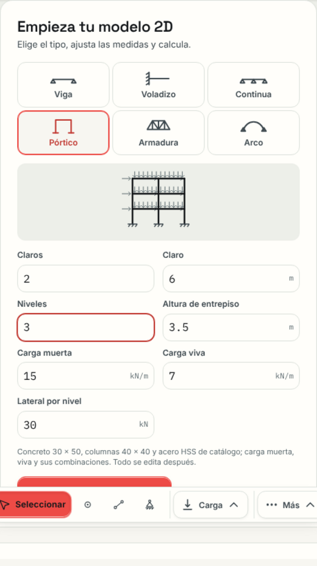
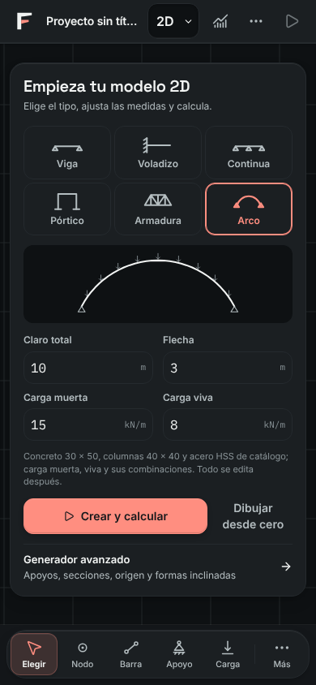
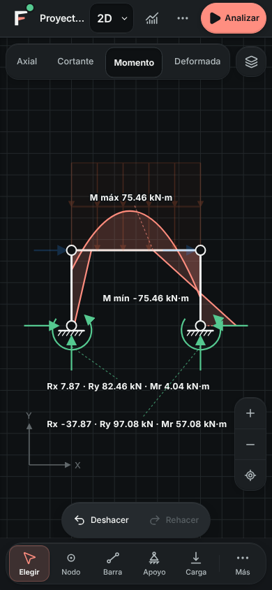
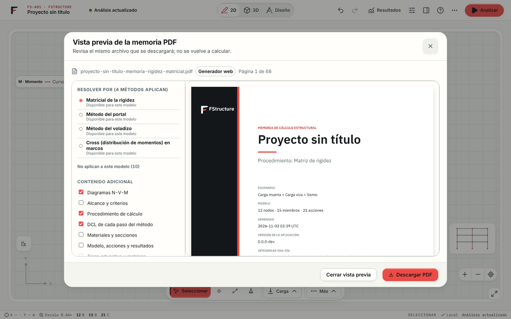
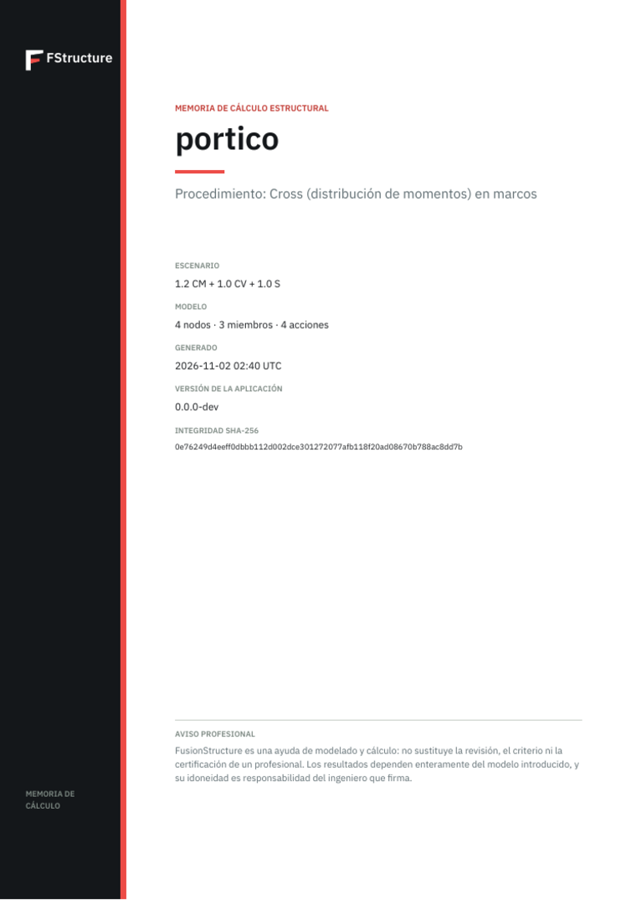
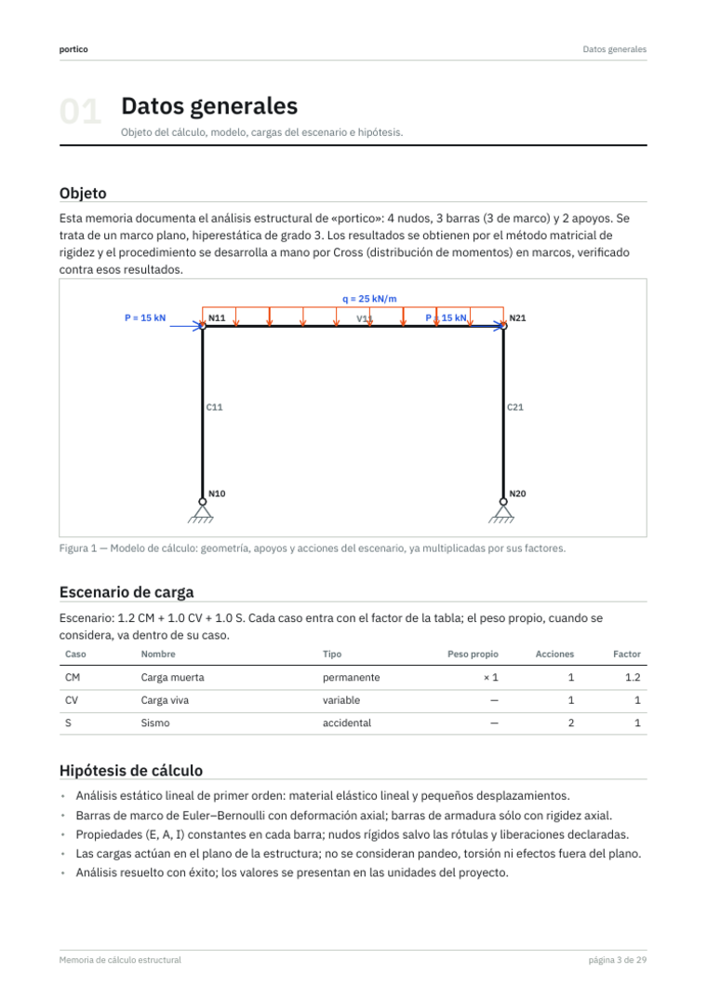
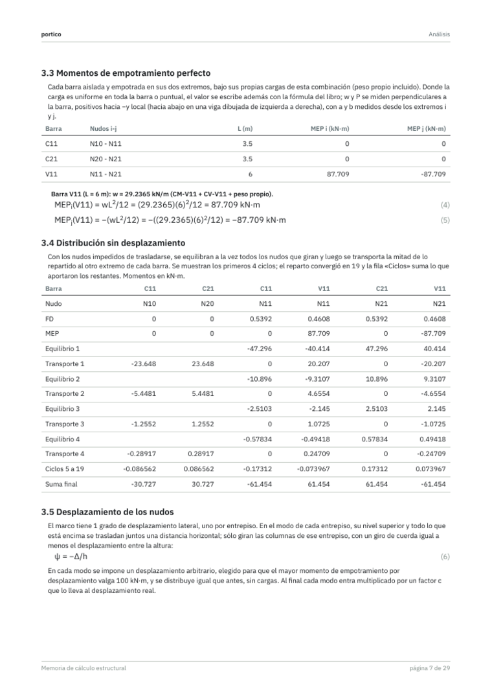
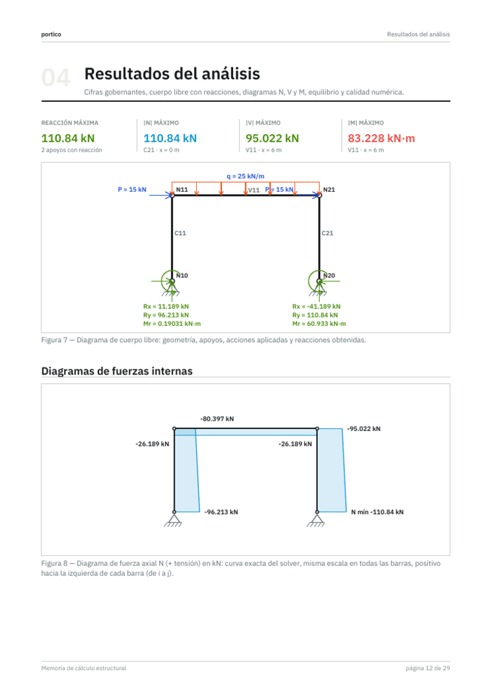
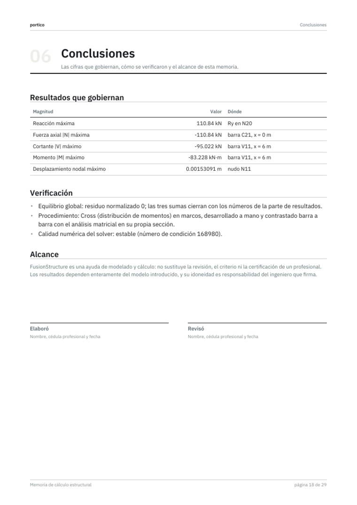

# FStructure · Creación rápida y memoria de cálculo · 31 de octubre – 2 de noviembre de 2026

**Estado: implementado y verificado** (`npm run check`, `npm run smoke` 64/64, revisión página a página de las memorias de cada método).

## Modelo 2D: crear rápido, ajustar después

El Modelo 2D vacío ofrece la **creación rápida**: el tipo en un toque (Viga, Voladizo, Continua, Pórtico, Armadura, Arco), sus pocas medidas en las unidades del proyecto con una vista previa a escala que dibuja las cargas, y **Crear y calcular**. Lo creado lleva sección, material, casos de carga y combinaciones del catálogo, y todo se edita después. El **Generador avanzado** (apoyos, secciones, origen y formas inclinadas) queda a un clic y ya no se abre encima de la tarjeta.

| Decisión | Por qué |
| --- | --- |
| Tipos en mosaicos de 3 × 2 con silueta | Se elige sin leer; a 390 px caben sin desplazar. |
| Campos en dos columnas, cifras en Plex Mono a 16 px | Comparación vertical de medidas; Safari no amplía al enfocar. |
| Vista previa con cargas | El modelo que se va a calcular se ve antes de crearlo. |
| El acento sólo en el tipo elegido y en «Crear y calcular» | Una acción principal por superficie. |
| Con el modelo vacío, «Analizar» es secundario y la Home dice «Empezar a modelar» | No hay nada que analizar ni que continuar. |

En resultados, un modelo grande sólo fuerza el extremo global y los de la barra elegida; las cargas ceden y se atenúan bajo un diagrama y la leyenda reserva su caja. En el teléfono las reacciones de cada apoyo van en una sola línea.

## Memoria de cálculo PDF

La memoria sigue el orden de una memoria de oficina: **Datos generales** (objeto, tipo y grado de la estructura, modelo de cálculo, escenario con cada caso y su factor, hipótesis) → **Materiales** → **Análisis** por el método elegido → **Resultados** (cuerpo libre con reacciones, diagramas N/V/M, equilibrio, reacciones) → **Cálculo por tramo** → **Conclusiones** (cifras que gobiernan, verificación, alcance y firmas) → **Anexos A–D**.

| Elemento | Canon aplicado |
| --- | --- |
| Tipografía | IBM Plex Sans incrustada en subconjunto (familia de la Plex Mono de la marca); cuerpo 10 pt, tablas ≥ 8.2 pt. Sin ella, las fuentes estándar. |
| Fórmulas | Índices y exponentes reales a tres alturas; regla = sustitución = resultado en un renglón o alineadas en el «=». |
| Color | Acento de la familia Análisis (`#C23A33` en texto, `#ED4B46` en la franja de la marca); N, V y M con sus señales; tensión azul y compresión roja en armaduras. |
| Marca | La ménsula con la franja roja y «FStructure» en la portada; la portada nombra el procedimiento de esa copia. |
| Dibujos | Cargas sumadas con los factores del escenario y rotuladas con su magnitud; reacciones apiladas bajo su apoyo; arcos sobre su curva; las cifras buscan hueco y no cruzan barras. |

El diálogo de exportación ofrece primero los métodos que aplican al modelo y pliega los demás con su motivo.

Pendiente: la comprobación física en Safari/iPhone de la descarga del PDF y del teclado de los campos de la creación rápida.
