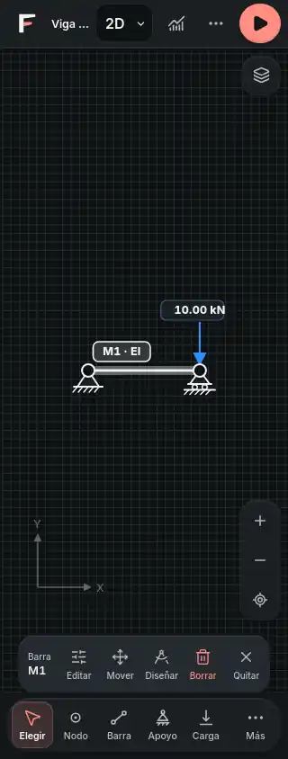

# FStructure · encuadre móvil y selección legible

26 de octubre de 2026 · base `2bd4a6265a1f3d06b6fae173f9fa5fda085afa9f`

## Problemas y cambios

El encuadre imponía una escala mínima de 24 píxeles por metro. Una viga de 13 m no cabía dentro del área libre de un teléfono de 320 px aunque se pulsara Ajustar. Además, el zoom y el pellizco imponían otro mínimo de 15 px/m: alejar una vista más distante podía acercarla de golpe.

Se unifica el límite inferior de cámara y se permite que el encuadre reduzca la escala lo necesario. Permanecen el límite superior y las comprobaciones de números finitos. La reserva existente para flechas y apoyos sigue activa. La corrección se aplica al ajuste inicial de un modelo y al botón Ajustar modelo a la vista. Se comprobaron vigas de 13, 60 y 1,000 m y un pórtico alto en horizontal.

No se introducen efectos que reencuadren al dibujar o cambiar la selección. Las cámaras manuales recordadas al cambiar de modo siguen conservándose; no se añadió un algoritmo que las sustituya si la persona dejó el modelo fuera de pantalla. En ese caso sigue disponible Ajustar.

La cápsula de selección conserva las mismas acciones y añade verbos visibles: Editar, Mover, Diseñar, Borrar y Quitar. El nombre accesible identifica el elemento, por ejemplo Editar barra M1. La ficha muestra tipo e identificador. A 320 px se retira únicamente el icono redundante de esa ficha para dejar sitio al texto; no desaparece ninguna acción.

Cuando no hay selección y existe historial, la misma cápsula ofrece Deshacer y Rehacer. Aparece después de borrar y permite recuperar también las barras y cargas afectadas al eliminar un nudo. Los botones actúan sobre el historial actual: no hay una notificación antigua capaz de deshacer una edición diferente mediante un callback atrasado. No se modifica el sistema de historial ni de almacenamiento.

El material sigue siendo clay discreto: una superficie contextual y controles sin cajas adicionales. Los objetivos de las acciones se comprobaron con un mínimo de 44 px; el nombre completo sigue disponible para tecnologías de asistencia.

## Evidencia visual

Captura real de WebKit a 320 × 844 px, tema Noche. No es un render conceptual ni una prueba en iPhone físico.

## Verificación

- Nueve pruebas nuevas fallaron antes de los cambios y pasan después: siete de encuadre/zoom/pellizco y dos de selección/historial.
- `npm run check`: salida 0; 1,639 pruebas en 233 archivos, arquitectura, siete referencias Python y compilación.
- `npm run verify`, `npm run lint:design` y compilación final: salida 0. Verificación dirigida final: 34 pruebas en cinco archivos.
- `node scripts/smoke.mjs`: 64 de 64 pantallas de la aplicación compilada, incluidos Inicio, Proyectos, 2D, 3D y Diseño, a 390 y 1440 px en ambos temas.
- Doce recorridos táctiles: seis en Chromium y seis en WebKit, a 320 × 844, 390 × 844 y 844 × 390, Día/Noche. Apertura con encuadre, alejar, ajustar, seleccionar barra, borrar, deshacer, analizar y recargar. Sin desbordamiento horizontal ni errores de ejecución en esos recorridos.
- Dos recorridos adicionales en Chromium a 390 px verifican que añadir un nudo no cambie la escala y que al girar a 844 × 390 se conserve el zoom.
- Los ocho archivos de código y pruebas transferidos coinciden por hash con los verificados.

## Límites y observaciones

WebKit emulado no equivale a Safari en un iPhone físico: teclado virtual, áreas seguras reales y app instalada siguen sin comprobarse en ese dispositivo. WebKit avisa que ignora la propiedad de viewport `interactive-widget`; se registró por separado de los errores de ejecución, sin modificar el comportamiento de Chromium. El recorrido de la aplicación compilada usa el botón Después si aparece el aviso de nueva versión, no elimina el aviso mediante CSS.

No se modificaron solver, datos estructurales, unidades, rutas, dependencias de producto ni persistencia. Permanecen advertencias anteriores de lint y tamaño de archivos compilados, sin errores de lint. La ejecución fue directa con Superpowers: Codex seguía sin una sesión autenticada; no se atribuye trabajo a agentes auxiliares.
