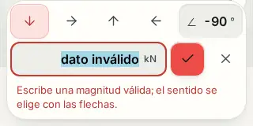

# FStructure · cargas editables sin cambios accidentales

26 de octubre de 2026 · base `6daf23d8384c66bf62d4944313083b0062bf3d35`

## Fallos reproducidos

La dirección de una carga se escribía al tocar una flecha, antes de confirmar. Cerrar el editor conservaba ese cambio. Un valor inválido cerraba el editor sin explicar el problema. El estilo de reposo de la barra superior también pisaba sus estados de pulsación y expansión.

## Correcciones

- Magnitud, ángulo y sentido viven en un borrador. Aplicar confirma los cambios juntos; cerrar o Escape los descarta. Una sola acción Deshacer recupera la carga anterior.
- El campo abre con su valor actual seleccionado. Un dato inválido conserva lo escrito, marca el campo, muestra una explicación y devuelve el foco. Las unidades permanecen visibles.
- La magnitud conserva la convención previa de valor absoluto; el sentido se elige con flechas o ángulo. La conversión de unidades ocurre una sola vez. Confirmar sin editar no redondea los valores ni añade un cambio al historial.
- El borrador no sobrescribe otra carga, otro proyecto, unidades distintas ni una modificación externa. Cambiar selección o herramienta cierra el editor.
- Las cargas distribuidas conservan ceros, proporciones y signos relativos al rotar. Se preservan coordenadas local/global, intervalos, caso y posición de cargas de barra. Un momento llevado a cero no se convierte en una fuerza.
- La barra superior mantiene el acabado tranquilo en reposo, pero recupera el hundimiento clay al pulsar. El estado expandido ya no se borra. Aplicar conserva su acento principal.

Se extrajeron `MobileLoadEditor.tsx` y `loadEdit.ts` del dock. No se modificaron el solver, el almacenamiento, las rutas, las dependencias ni el algoritmo de encuadre.

## Captura

Recorte de la interfaz real a 320 px, tema Día. No es una maqueta.

## Verificación

- TDD: siete de las ocho pruebas nuevas del dock fallaban antes del cambio. Después pasan las ocho. Una prueba adicional reprodujo pérdida de admisión de magnitudes originales pequeñas; también quedó corregida.
- 27 pruebas nuevas: ocho del editor integrado y diecinueve de la transformación pura. 40 pruebas específicas pasan junto a las regresiones existentes.
- `npm run check`: salida 0, 1,630 pruebas en 231 archivos, arquitectura, siete referencias Python y compilación.
- `npm run verify`: salida 0. `npm run lint:design`: guía de diseño en línea.
- `node scripts/smoke.mjs`: 64 de 64 pantallas de la aplicación compilada.
- Seis recorridos Chromium con entrada táctil: 320×844, 390×844 y 844×390, Día/Noche. Seleccionar carga real → escribir dato inválido → corregir → cambiar dirección → cancelar → reabrir → confirmar → analizar → recargar. El editor permanece dentro de la ventana, con campos de al menos 16 px, sin desbordamiento horizontal ni errores de página/consola en esos recorridos.
- Doce comprobaciones de pulsación en la barra: marca, nombre y acción secundaria, a 390 y 1440 px, Día/Noche. Se compararon estilos calculados con el puntero presionado. El caso fallaba antes de corregir la cascada y pasa después.
- Los ocho archivos de código y pruebas transferidos a GitHub coinciden por hash con los del entorno verificado.

## Límites

Los agentes no pudieron ejecutarse: Codex no tenía una sesión autenticada. La implementación, revisión y pruebas fueron directas; no se atribuye revisión independiente. El navegador conectado tampoco tenía contexto disponible, por lo que se utilizó Playwright Chromium. No se verificaron Safari, teclado virtual ni áreas seguras en un iPhone físico. Las advertencias previas de lint y tamaño de chunks permanecen, sin errores de lint. El nuevo encuadre automático, las etiquetas de selección y el aviso de deshacer tras borrar no forman parte de esta entrega.
