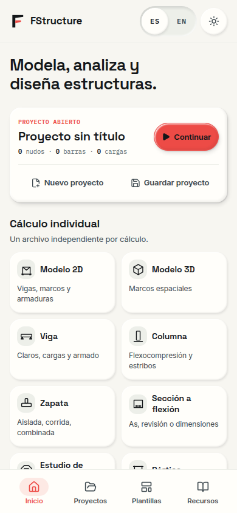
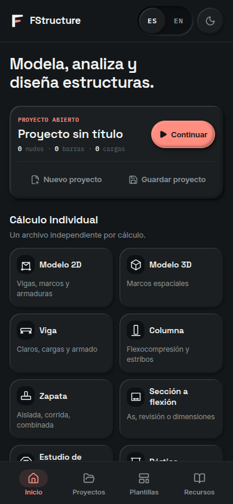
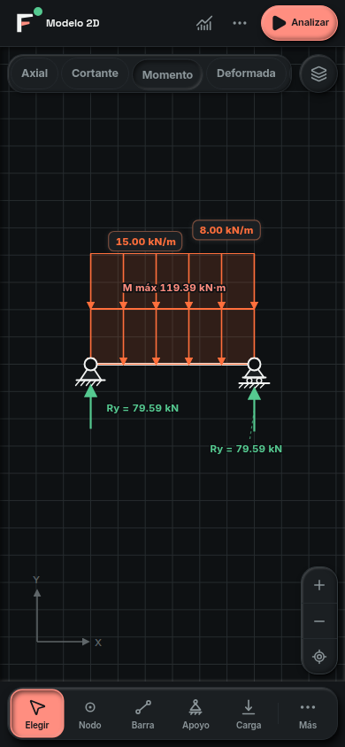
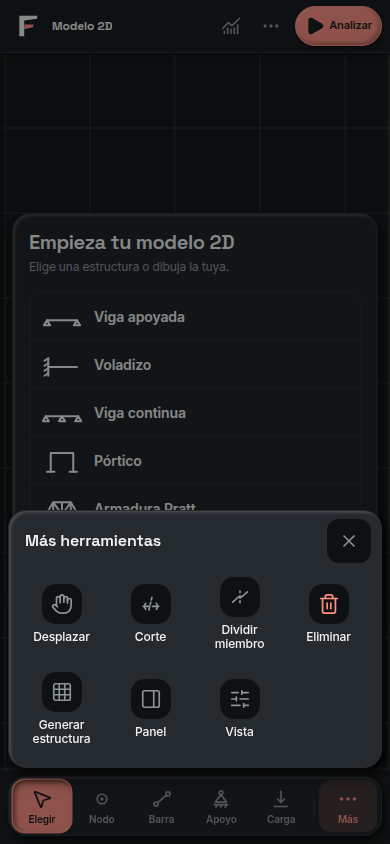
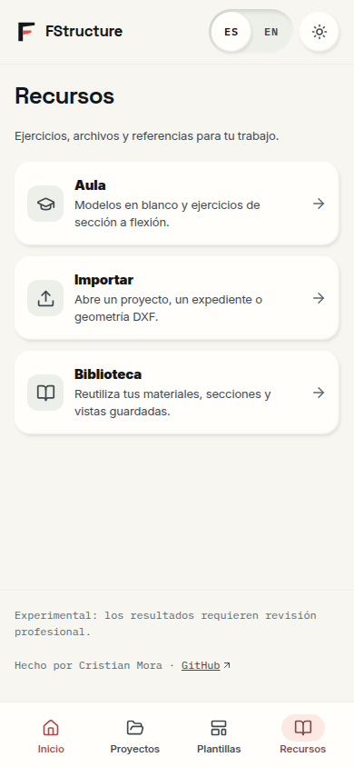
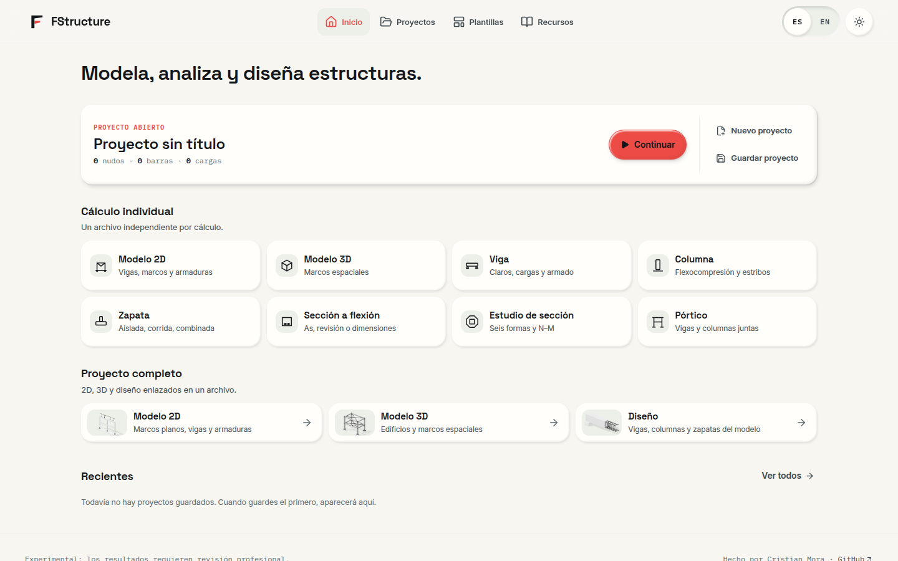

# FStructure · Interfaz móvil

25 de octubre de 2026.

La actualización facilita retomar un cálculo, encontrar sus herramientas y trabajar con el teléfono. Conserva la marca de Análisis, los temas Día/Noche y los flujos de cálculo individual y proyecto completo.

## Decisiones

| Antes | Después | Motivo |
| --- | --- | --- |
| Los recursos aparecían en la portada y había que volver a ella para cambiar de sección. | Navegación persistente: Inicio, Proyectos, Plantillas y Recursos; inferior en teléfono y superior en escritorio. | Mantener las secciones principales a un toque, también al desplazarse. |
| El proyecto abierto y la lista vacía de recientes ocupaban gran parte de la primera pantalla. | Proyecto más compacto, Continuar como acción principal, Nuevo/Guardar secundarios y herramientas antes de recientes. | Dar espacio a la siguiente acción sin ocultar archivos ni crear datos ficticios. |
| Las piezas tenían sólo título en móvil. | Icono, nombre y una descripción breve de cada herramienta. | Distinguir el cálculo que se abrirá sin depender de un tooltip. |
| El dock 2D mostraba únicamente iconos. | Elegir, Nodo, Barra, Apoyo, Carga y Más, con nombres accesibles equivalentes. | Reconocer las herramientas con vista, lector de pantalla o control por voz. |
| Más herramientas no tenía cierre explícito ni confinaba Tab. | Hoja con título, cierre de 44 px, límite de altura, desplazamiento interior y gestión de foco. | Poder salir y recorrerla sin caer en el contenido del fondo. |
| El viewport y los listeners globales impedían ampliar formularios. | Zoom del navegador permitido fuera del lienzo y campos de al menos 16 px en pantallas táctiles. | Leer y escribir con accesibilidad sin el zoom automático de campos pequeños. |
| Una reducción de VisualViewport se trataba siempre como teclado. | Detección de campo editable y geometría de zoom/teclado diferenciadas; la altura elegida del inspector se conserva al ampliar. | Evitar que un pellizco oculte herramientas o cambie preferencias. |

La Home conserva sus rutas anteriores. Recursos añade `?surface=welcome&view=resources`. Atrás/Adelante restauran la sección y cierran los diálogos de la sección abandonada. Los cálculos, el guardado y los formatos existentes siguen usando sus implementaciones anteriores.

## Movimiento y toque

Se aplicaron las guías originales [emil-design-eng](https://github.com/emilkowalski/skills/blob/main/skills/emil-design-eng/SKILL.md) y [mobile-native](https://github.com/emilkowalski/skills/blob/main/skills/mobile-native/SKILL.md), de Emil Kowalski. La Home limita hover a un puntero preciso; los controles responden al pulsar, la hoja de herramientas aparece en 180 ms y el contexto de una herramienta cambia sin una animación repetitiva. Se respeta la preferencia de movimiento reducido.

El dock reserva el área segura inferior completa. El selector compacto conserva espacio para «Diseño» con la fuente táctil de 16 px. El documento mantiene el zoom de accesibilidad; sólo el lienzo gestiona sus propios gestos.

## Verificación

- `npm run verify`: tipos, lint y pruebas relacionadas con los archivos cambiados.
- `npm run check`: gate completo de publicación, incluidas arquitectura, suite de pruebas, oráculo de diseño y compilación.
- `npm run smoke`: 36 pantallas, incluida Recursos, a 390 y 1440 px en Día/Noche.
- Navegación Inicio → Recursos → Proyectos → Atrás → Inicio → Modelo 2D → Viga apoyada y análisis resuelto a 320 × 740, 390 × 844, 768 × 1024, 844 × 390 y 1440 × 900. Sin desbordamiento horizontal ni errores de ejecución en esos recorridos.
- Revisión adicional de las mesas 3D y Diseño a 320, 390 y 1440 px.
- Pruebas de foco del dock, regreso con diálogo abierto y separación de zoom/teclado. Revisión independiente y corrección de los nombres accesibles de las herramientas.

Las capturas proceden de Chromium con tamaños de pantalla y entrada táctil emulados. Se comprobaron el zoom del navegador a 2× y los campos a 16 px. No sustituyen una prueba física de Safari/iPhone, su teclado, la isla dinámica o el modo PWA instalado.

## Capturas actuales

### Inicio · teléfono · Día

### Inicio · teléfono · Noche

### Modelo 2D · teléfono · Noche

### Más herramientas · teléfono · Noche

### Recursos · teléfono · Día

### Inicio · escritorio · Día

