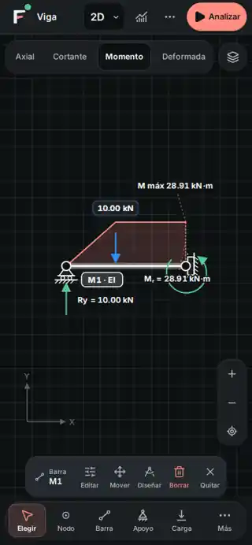

# FStructure · analizar sin avisos rutinarios

26 de octubre de 2026 · base `9bbfd73c7f1bf4192aa05311f36635877b74917b`

## Cambio solicitado

El aviso de cálculo completado y el de rigidez relativa ya no aparecen encima del lienzo. No se acortó su temporizador ni se ocultaron mediante CSS: el hook consume la petición y no emite una notificación para los tonos informativos o de éxito de la política existente. Los resultados siguen dibujándose y se consultan desde el botón persistente Resultados.

Las advertencias y los errores conservan exactamente la clasificación, el contenido y la duración que ya tenían. No se cambió `analysisFeedback`, el solver, los diagnósticos originales, los umbrales numéricos, apoyos, cargas ni datos guardados. Un resultado informativo no equivale a una validación física.

También se redujo «Notas del cálculo» a «Notas» y la introducción repetitiva de rigidez relativa a una sola frase. El apartado sigue plegado por defecto salvo cuando contiene errores; dentro conserva título, explicación y corrección sugerida de cada diagnóstico. No se retiraron etiquetas útiles de herramientas ni sus nombres accesibles.

## Evidencia visual

Captura real del caso reconstruido de la viga con momento de 28.91 kN·m, después de analizar. Chromium táctil a 390 px, tema Noche; imagen reducida para la ficha.

## Verificación

- Se reprodujo el fallo antes del cambio: los análisis físico y relativo emitían notificaciones repetidas. Las dos pruebas de silencio pasan tras la corrección.
- Seis pruebas nuevas cubren silencio, repetición, errores de apoyos, alertas de guardado independientes, calidad numérica limitada/no fiable y advertencias físicas. Verificación dirigida: 37 pruebas en seis archivos.
- `npm run check`: salida 0; 1,658 pruebas en 236 archivos, arquitectura, siete referencias Python y compilación.
- `npm run verify`, `npm run lint:design` y `git diff --check`: salida 0.
- Pruebas de humo de la aplicación compilada: 64 de 64 pantallas.
- Nueve escenarios en Chromium, repetidos en desarrollo y compilación: 320, 390 y 1440 px, Día/Noche, con tres análisis por vista, cero eventos de aviso rutinario y cero aperturas de Doctor. Resultados se abre con su botón real, las notas se despliegan y el modelo se vuelve a analizar tras recargar. No hubo desbordamiento horizontal ni errores de ejecución en esos recorridos.
- Los tres escenarios adicionales comprobaron rigidez física válida sin aviso, rigidez física con deformación excesiva conservando advertencia y estructura sin apoyos conservando error.
- Los cuatro archivos de código/pruebas transferidos coinciden por hash con los ejecutados.

## Alcance y límites

El cambio se limita al flujo de análisis 2D y al texto de sus notas, no a todos los avisos de la aplicación. Los errores ya visibles siguen cerrándose con su control explícito; no se implementó borrado automático de errores anteriores. Los cambios amplios de gestión de avisos se descartaron y se mantuvo intacto el ciclo de vida de las advertencias.

El navegador conectado no tuvo contexto disponible; se utilizó Playwright Chromium. No se probó este cambio en WebKit ni en Safari de un iPhone físico. Permanecen las advertencias previas de lint, `act` y tamaño de archivos compilados, sin fallos de pruebas ni de compilación. Ejecución directa con Superpowers, sin atribuir revisión a agentes auxiliares.
