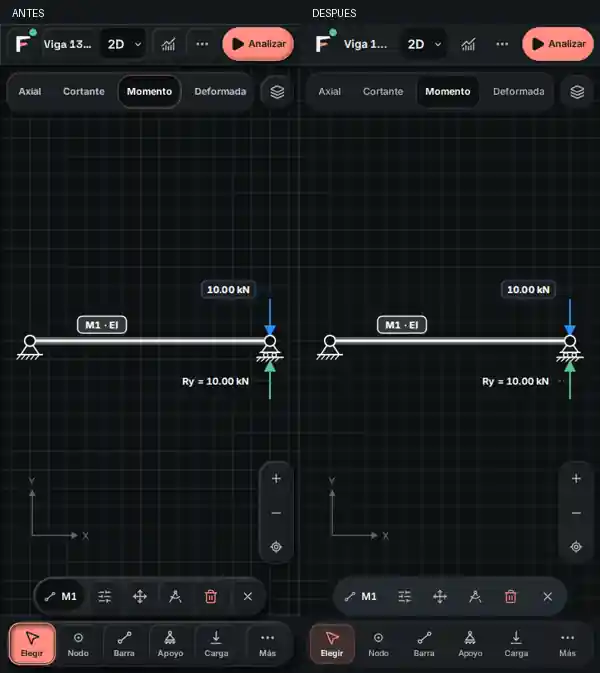

# FStructure · arcilla discreta

26 de octubre de 2026 · base `030e59d6e5ebe8690ec5e351e8807fa64b45594f`

## Qué cambia

El problema visual era la acumulación de relieve: bandejas elevadas con teclas también elevadas, recuadros dentro de tarjetas y sombras demasiado presentes. El nuevo perfil conserva la materia clay mediante sombras de contacto pequeñas, una luz interior fina y profundidad en acciones principales y superficies flotantes.

- Barra superior: el nombre del proyecto, la marca y los controles secundarios dejan de parecer teclas separadas. Analizar conserva su acento y relieve.
- Herramientas 2D: una bandeja con teclas tranquilas; la activa conserva fondo, borde, icono de acento y mayor peso de etiqueta. El texto de selección mantiene alto contraste.
- Resultados y zoom: pestañas inactivas sin cajas independientes; selección hundida y controles agrupados.
- 3D y Diseño: las familias de controles comparten sombras más suaves; pestañas, encabezados y grupos reducen elevaciones anidadas. Los estados de selección, peligro y deshabilitado siguen siendo distintos.
- Inicio y sus secciones: tarjetas con elevación suave, iconos sin un segundo recuadro interior, títulos de peso moderado y más separación entre título y descripción.
- Tema Noche: retícula menos dominante. No cambian los colores de las fuerzas, momentos, deformadas ni advertencias.
- Pantallas táctiles anchas: Capas en 3D y herramientas compactas del 2D respetan 44 × 44 px, también en horizontal o en escritorio táctil.

La implementación está en `src/design-system/softClay.css` y una importación en `main.tsx`. No modifica cálculo, geometría, archivos guardados, exportaciones, rutas ni dependencias. La menor intensidad de sombras es una adaptación de FStructure solicitada por el usuario, no un cambio al repositorio del canon.

## Antes y después

Mismo modelo de prueba, ventana y tema; capturas con las fuentes cargadas. La comparación anterior desactiva únicamente el nuevo perfil de presentación.

## Verificación

- Suite base: 1,603 pruebas en 229 archivos.
- `npm run check`: 1,603 pruebas, comprobaciones de arquitectura, siete referencias Python y compilación, con salida 0.
- `npm run verify`: salida 0. La compilación final incluye los últimos ajustes CSS de contraste y objetivos táctiles.
- `npm run lint:design`: guía de diseño en línea.
- `node scripts/smoke.mjs`: 64 de 64 pantallas de la aplicación compilada.
- 24 recorridos responsivos: 2D, Datos de una viga en Diseño y generador 3D, a 320 × 844, 390 × 844, 844 × 390 y 1440 × 900, Día/Noche. Sin desbordamiento horizontal, errores de página o de consola en esos recorridos.
- Revisiones específicas: analizar la viga de 13 m, alternar Cortante/Momento, abrir Más herramientas, Datos y el generador 3D. La selección sigue siendo operable.
- Texto de la herramienta móvil activa: contraste medido 14.73:1 en Día y 11.43:1 en Noche. Foco de teclado visible de 2 px. Objetivos táctiles corregidos de Capas 3D y Nodo 2D: 44 × 44 px.
- Capturas de Inicio, Proyectos, Modelo 2D, Modelo 3D y Diseño en ambos temas; Inicio también a 1440 px.

## Guías y límites

Referencias consultadas: [Emil Kowalski · Design Engineering](https://github.com/emilkowalski/skills/tree/main/skills/emil-design-eng), [Apple Design](https://github.com/emilkowalski/skills/tree/main/skills/apple-design) y [Apple HIG · Buttons](https://developer.apple.com/design/human-interface-guidelines/buttons). Se aplican jerarquía, contención visual, estados claros y objetivos táctiles sin esconder funciones.

La revisión se realizó directamente y con pruebas automatizadas. El agente auxiliar de revisión falló al autenticarse (401); no se presenta como una revisión independiente realizada. Se probó Chromium con entrada táctil emulada, no Safari en un iPhone físico. La cobertura es de las familias compartidas y los recorridos descritos, no una certificación manual de todos los estados posibles de cada diálogo. Permanecen advertencias previas de lint y tamaño de archivos compilados; no hubo errores de lint. No se cambió el algoritmo de encuadre.
